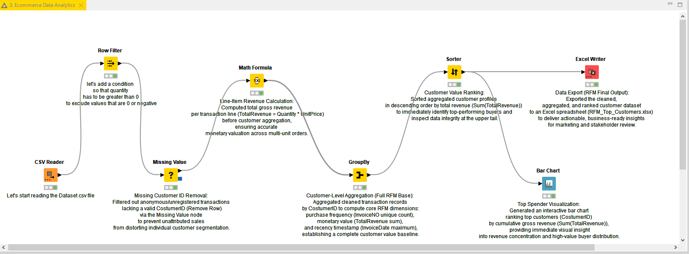

# 📊 E-Commerce RFM Customer Segmentation & Analysis in KNIME

A practical, node-based data analytics workflow built in **KNIME Analytics Platform** to evaluate customer value using **RFM (Recency, Frequency, Monetary)** analysis on real-world e-commerce transactional data.

---

## 🛠️ Workflow Architecture
The workflow cleans raw transactional records, engineers business metrics, aggregates data at the customer level, and visualizes top-performing buyers.

### Key Processing Steps:
1. **Data Cleaning:** Filtered out returns/cancellations (`Quantity > 0`) and removed anonymous transactions lacking a valid `CustomerID` using the *Missing Value* node.
2. **Feature Engineering:** Calculated line-item gross revenue (`TotalRevenue = Quantity * UnitPrice`) via the *Math Formula* node.
3. **Customer Aggregation:** Consolidated records by `CustomerID` using the *GroupBy* node to compute purchase frequency (`InvoiceNo` unique count), total monetary value (`Sum(TotalRevenue)`), and last purchase date (`Max(InvoiceDate)`).
4. **Ranking & Visualization:** Sorted customers by revenue contribution and generated an interactive **Bar Chart** to isolate top spenders.
5. **Business Deliverable:** Exported the cleaned, ranked dataset to an Excel spreadsheet (`RFM_Top_Customers.xlsx`) via *Excel Writer*.

---

## 📈 Key Insights & Results

* **Revenue Concentration:** Successfully isolated the top 10 highest-value customers, highlighting strong revenue concentration consistent with the Pareto principle (80/20 rule).
* **Data Integrity:** Eliminated analytical distortions caused by unattributed guest checkouts (missing `CustomerID` records).

---

## 🚀 How to Run
1. Download the KNIME workflow file (`.knar`) from the `workflow/` folder.
2. Open **KNIME Analytics Platform**.
3. Import the workflow via **File > Import KNIME Workflow...**
4. Explore the final output table directly in the `output/` folder (`RFM_Top_Customers.xlsx`).
